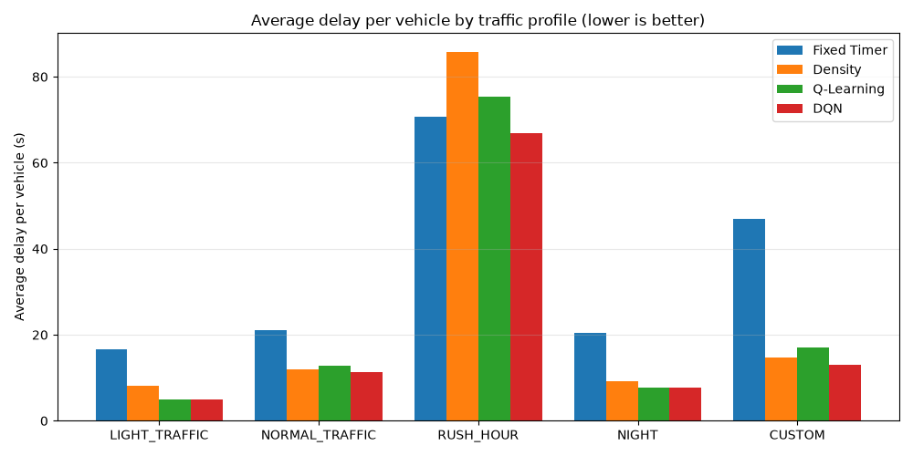

# IntelliFlow: Intelligent Multi-Phase Traffic Control

A simulator and controller study for a single 4-way intersection. It compares a
fixed-time signal, a rule-based adaptive controller, and two reinforcement-learning
agents (tabular Q-learning and a DQN written from scratch in numpy) on the same
seeded traffic, with ambulance preemption handled by safety rules that no learned
policy can override.

- **16 movements**: 4 approaches × (left, straight, right, U-turn), left-hand traffic.
- **A 6-phase signal plan that is conflict-free by construction** (derived from the movements'
  paths and re-checked by the tests), with 2 s all-red clearance between phases, plus a
  dynamic emergency phase per approach.
- **5 traffic scenarios**: light, normal, rush hour (over capacity), night (truck-heavy), and a time-varying custom day.
- **Deterministic and seeded**: every reported number is reproducible from the code.

## Results at a glance

10-minute runs, 5 scenarios × 5 test seeds; RL is the mean ± std of 3 independent training runs.
Full tables, per-scenario breakdowns and confidence intervals:
[results/model_cards.md](results/model_cards.md) (regenerated by `run_experiments.py`).

| Controller | Avg delay / vehicle | Longest wait | Avg queue | Throughput | Ambulance delay |
|---|---|---|---|---|---|
| Fixed Timer | 35.1 s | 201 s | 72.4 | 1.236 veh/s | 17.0 s |
| Density (rule-based) | 26.0 s | 125 s | 66.0 | 1.249 veh/s | 16.7 s |
| Q-Learning | 23.6 ± 0.8 s | 119 s | 60.2 | 1.266 veh/s | 14.3 s |
| **DQN** | **20.8 ± 0.1 s** | **112 s** | **52.6** | **1.284 veh/s** | **11.9 s** |

**In short:** the DQN cuts average delay by 20% versus the rule-based Density controller
(−5.2 s per vehicle, 95% CI [−8.2, −2.6]) and by 41% versus a fixed-time signal, with a
shorter worst-case wait, and it is best in all five traffic profiles. It runs inside a rule-based
safety envelope (never green for an empty phase while vehicles wait elsewhere, a 90 s
maximum red, fixed rotation if the camera fails). Its reward weighs every waiting vehicle by
how long it has waited, so many long-waiting vehicles count more than one. With simulated
camera errors it loses about 4% (21.7 s). Turn intent can be read the way a camera would, from
each car's heading (drivers angle toward their exit near the stop line): with that plus the
camera errors, 21.7 s. Both RL rows include the safety envelope.



## Watch it

```bash
python visualize.py            # records every scenario and opens simulation_viewer.html
```

The viewer replays Fixed Timer, Density and the DQN side by side on identical traffic:
signals, queues (coloured by how long the front car has waited), ambulances, safety-rule
actions, a camera-outage badge, a queue chart and an end-of-run table, for the 5 standard
profiles and the 12 edge cases below. Every frame is recorded from the real simulator.

## Edge cases and what is guaranteed

`python -m evaluation.stress_test` runs every controller through 12 hand-built situations
(empty junction, a lone car per lane at night, a flooded lane, main road vs side road,
400 cars at once, a sudden surge, all trucks, ambulances on every approach at once, an
ambulance stuck behind a queue, an ambulance every 20 s, demand 30% above capacity, a
camera outage) and checks the safety rules on **every tick**. Results:
[results/stress_test.md](results/stress_test.md).

- **Guaranteed by rules and verified on every tick of every scenario (0 violations):** no
  phase lets crossing paths go together (checked geometrically), only the active phase's lanes
  are green, yellow and then all-red before every switch, every green 5–40 s, no vehicle lost,
  every ambulance served.
- **Measured, not guaranteed:** the DQN has the lowest average delay in 7 of the 11
  non-empty edge cases. Its longest wait is above both baselines in four: a sudden surge
  (102 vs 92 s), ambulances on all four approaches at once (103 vs 86 s), demand beyond
  capacity (404 vs 395 s) and the camera outage (113 vs 84 s). Seen through a realistic camera
  (detection errors, intent read from heading) it stays safe, with longer worst waits under
  overload.
- No controller can be proven optimal in every case. The learned policy is kept inside a
  rule-based envelope so its failures are bounded: without it, a lone car at an empty
  junction waited 332 s; with it, 14 s.

## Quickstart

```bash
pip install -r requirements.txt     # numpy, matplotlib, pytest

python main.py                      # live console simulation (Fixed Timer, 100 ticks)
python run_experiments.py           # train RL (3 seeds x 2 agents, parallel) + evaluate all (~3 min)
python run_experiments.py --use-saved   # re-evaluate saved models only (~10 s)
python -m pytest                    # 103 tests (~40 s)
python visualize.py                 # build and open the simulation viewer
python -m evaluation.stress_test    # edge cases + safety invariants -> results/stress_test.md
```

Pick a controller and scenario in code:

```python
from simulation import Simulation
sim = Simulation(strategy_key="density", profile_key="RUSH_HOUR", seed=1, live=False)
```

## How it works

```
traffic_source ──spawn──▶ Intersection (16 lanes) ◀──discharge── ServiceModel
                               │                                (green time per vehicle type)
                               ▼
                       TrafficScheduler ──"which phase next? how long?"──▶ Strategy
                       (green → yellow → next,                    FixedTimer | Density | RLStrategy
                        ambulance preemption first)
```

- **The scheduler is generic.** It runs green → yellow → next phase, and asks a pluggable
  `Strategy` what to run next (Strategy pattern). Ambulance preemption is checked before
  any strategy is consulted.
- **Fixed Timer** rotates through the 6 phases with 12 s greens.
- **Density** ranks approaches by queue length, scores all 6 phases by how much
  high-density traffic they serve, and sizes green time from the longest queue
  (10–40 s). A phase-recency bonus keeps every phase reachable.
- **RL** (`perception/`, `env/`, `rl/`): the agent sees the junction through a per-lane
  summary (vehicle counts and how long each has waited), the same contract a camera
  pipeline will provide. Each time a green runs out it picks a phase: the same phase extends
  green by 5 s, another phase switches (Density's 10/40 s bounds). Its reward charges each
  waiting vehicle more the longer it has waited.

Details: [PROJECT_DOCUMENTATION.md](PROJECT_DOCUMENTATION.md).

## Project layout

```
core/             domain model: Vehicle, Queue, Lane, Signal, Movement, Approach, Phase, Intersection
config/           phase plan, timing, traffic profiles, Density and RL settings
scheduler/        TrafficScheduler (phase cycle + ambulance preemption state machine)
strategies/       FixedTimer, Density, RLStrategy (+ placeholders for future strategies)
traffic_source/   seeded profile-driven arrivals (+ YOLO / SUMO placeholders)
services/         service-time-aware vehicle discharge
analytics/        KPIs and per-tick CSV logging
perception/       what the controller sees: per-lane counts and waits (simulated; camera later)
env/              Gym-style RL environment and observation builder
rl/               tabular Q-learning, numpy DQN (MLP, Adam, replay), training loop
evaluation/       edge-case stress test + safety-invariant monitor; quick strategy comparison
viewer/, visualize.py   the simulation viewer (recorded replays)
tests/            pytest suite (CI: .github/workflows/tests.yml)
run_experiments.py   the controlled experiment that produces results/ and images/
```

## Status and roadmap

See [TODO.md](TODO.md). Planned integrations (not implemented yet): YOLO/OpenCV vehicle
detection, SUMO, a web dashboard, database logging.
